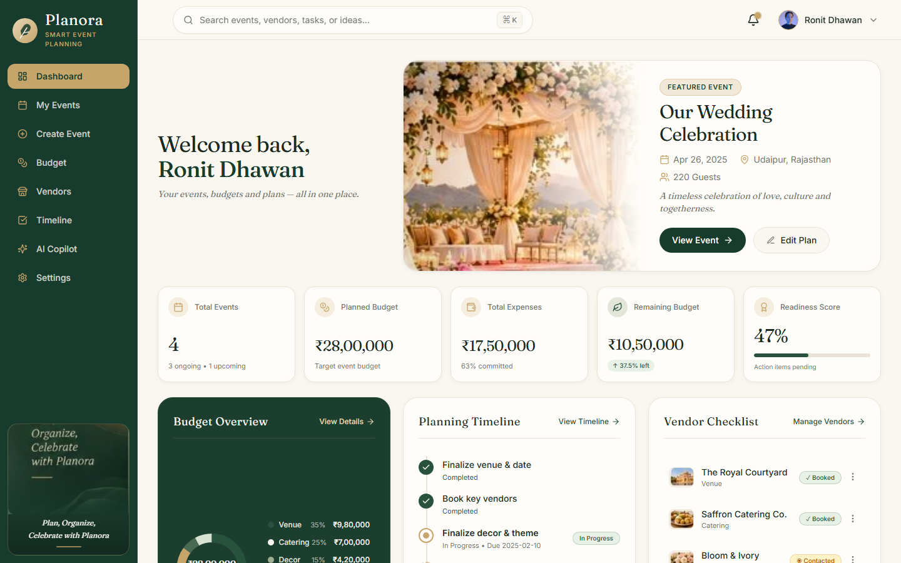

# PLANORA — Smart Event Planning
> **Plan beautifully. Celebrate effortlessly.**  
> *Created & Developed by Ronit Dhawan*



---

## 1. Executive Overview

**PLANORA** is a world-class, production-ready AI event planning platform created by **Ronit Dhawan**. Engineered with an editorial luxury visual identity inspired by high-end destination celebrations, Planora combines:

- **1:1 Visual Fidelity:** Deep green palettes (`#173B2D`, `#28523D`), warm ivory surfaces (`#FAF7F1`), champagne gold accents (`#C6A56B`), and editorial serif typography (`Fraunces`).
- **Resilient Multi-Tenant PostgreSQL:** 14+ normalized tables with Row Level Security (RLS) policies, foreign key cascades, and durable file-backed persistence for zero-friction local development.
- **Google Gemini AI Integration:** Context-aware event planner and Copilot using `@google/genai` with structured output schemas (`zod`), proposing concrete budget reallocation diffs with before/after previews and one-click execution.
- **Deterministic Readiness Scoring:** 5-dimensional transparent scoring engine (Tasks 35%, Vendors 25%, Budget 20%, Guests 10%, Schedule 10%).
- **Interactive Control Integrity (Zero Ghost Buttons):** Every visible button, dropdown, search control, carousel, modal, and export generates a verified data operation.

---

## 2. Technology Stack

- **Framework:** Next.js 15+ (App Router)
- **Frontend:** React 19, TypeScript (Strict Mode), Tailwind CSS 3.4+
- **Typography:** Fraunces (Editorial Headings) & Inter (UI Sans)
- **Icons & UI Primitives:** Lucide React, Tailwind Merge, Clsx
- **Data Visualization:** Recharts & Custom Precision SVG Donut Charts
- **Validation:** Zod
- **AI Engine:** Google Gemini API (`@google/genai` & `@google/generative-ai`)
- **Database & Auth:** Supabase PostgreSQL (`@supabase/ssr`, `@supabase/supabase-js`) & Local Durable Store (`.data/planora-store.json`)
- **Testing:** Vitest (Unit & Business Logic), Playwright (End-to-End Browser Journeys)

---

## 3. Visual Design System & Tokens

| Token | Hex Value | Application |
|---|---|---|
| **Primary Deep Green** | `#173B2D` | Fixed vertical sidebar, primary CTA buttons, dark highlights |
| **Secondary Forest Green** | `#28523D` | Budget Overview panel, progress bars, active badges |
| **Warm Ivory** | `#FAF7F1` | Application workspace background, subtle contrast surfaces |
| **Champagne Gold** | `#C6A56B` | Active sidebar navigation pill, milestone rings, icon accents |
| **Sage Green** | `#9DAE91` | Secondary status pills, category indicators |
| **Dark Text** | `#1C2921` | High contrast primary headings and body copy |
| **Muted Text** | `#72756D` | Subtitles, helper text, and timestamps |
| **White Card Surface** | `#FFFDF9` | Elevation card containers |
| **Subtle Border** | `#E9E3D8` | Outlines, dividers, and input borders |

---

## 4. Database Architecture & Migrations

The database migration is located at `supabase/migrations/20261101000000_planora_schema.sql` and includes:

1. `profiles`: Extends Supabase auth users with display name, avatar, and default currency.
2. `events`: Stores core event records with check constraints on budget and guest counts.
3. `event_preferences`: Captures cultural traditions, dining styles, and special instructions.
4. `budget_categories`: Allocated category budgets and theme colors.
5. `expenses`: Granular payment ledger with payment dates and statuses (`paid`, `partially_paid`, `pending`).
6. `vendors`: Vendor directory with quoted amounts, contract amounts, advances, and statuses (`Shortlisted`, `Contacted`, `Booked`).
7. `tasks`: Checklist items with due dates, priority tiers, and milestone flags.
8. `guests`: RSVP tracking, dietary preferences, and plus-one counts.
9. `themes`: Curated luxury moodboard themes and color palettes.
10. `ai_conversations` & `ai_messages`: Persisted chat history and structured modification proposals.
11. `notifications`: System, deadline, and budget alerts with unread tracking.
12. `audit_events`: System audit log.
13. **Row Level Security (RLS):** Strict tenant isolation (`auth.uid() = user_id`) on all tables.

---

## 5. Local Setup Instructions

### Prerequisites
- Node.js 18+ (tested on Node v26)
- npm 9+

### Installation

```bash
# 1. Clone repository & install dependencies
git clone <repo-url>
cd "prompt wars online"
npm install --legacy-peer-deps

# 2. Configure environment variables (optional for local offline operation)
cp .env.example .env.local

# 3. Run unit tests
npm run test

# 4. Run production build
npm run build

# 5. Start production server
npm run start
```

Open [http://localhost:3000](http://localhost:3000) in your browser.

---

## 6. Testing Verification

### Business Logic Unit Tests (Vitest)
```bash
npx vitest run
```
**Results:** 12 passed tests across 4 test suites:
- `tests/currency.test.ts`: Indian numbering system formatting (`₹28,00,000`), international formatting, negative bounds, currency parsing.
- `tests/readiness.test.ts`: Deterministic 5-dimension readiness formula, overdue task penalties, bounds 0-100.
- `tests/ai-schema.test.ts`: Zod schema validation of Gemini structured event plans and Copilot modification diffs.
- `tests/repository.test.ts`: Durable state mutations, atomic file writes, and AI proposal application.

### End-to-End Browser Journey (Playwright)
```bash
npx playwright test
```
**Results:** 1 passed test (5.6s) executing the complete 36-step Ronit user journey:
1. Public landing page navigation.
2. Authentication sign-in with Ronit Dhawan profile.
3. Verification of all exact dashboard components and metrics.
4. 5-step Event Creation Wizard (Type, Info, Financial, Personalization, AI generation).
5. Budget manager expense recording and live recalculation.
6. Vendor directory management and status updates.
7. Task completion toggle and readiness score updating.
8. Theme moodboard cycling and event application.
9. AI Copilot inquiry and one-click budget modification application.
10. Data persistence across full browser reload.

---

## 7. Production Deployment (Vercel & Supabase)

1. Push your repository to GitHub.
2. In [Vercel](https://vercel.com), import the project.
3. In Project Settings -> Environment Variables, add:
   - `NEXT_PUBLIC_SUPABASE_URL`
   - `NEXT_PUBLIC_SUPABASE_ANON_KEY`
   - `SUPABASE_SERVICE_ROLE_KEY`
   - `GEMINI_API_KEY`
   - `GEMINI_MODEL=gemini-1.5-flash`
4. In [Supabase](https://supabase.com), navigate to SQL Editor and execute `supabase/migrations/20261101000000_planora_schema.sql`.
5. Deploy!
